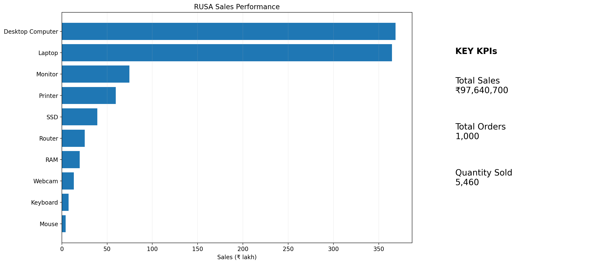

# SAP Databricks Sales & Inventory Analytics | RUSA Analytics

A portfolio demonstration of sales performance, inventory risk, fulfilment and slow-moving stock analysis.



## Explore the project

| Folder | Contents |
|---|---|
| [code_reference](code_reference/) | Two PySpark reference scripts for refinement and Gold transformations |
| [dashboard_reference](dashboard_reference/) | Four static reference mockups |
| [data/full](data/full/) | Six synthetic CSV tables |
| [data/sample](data/sample/) | Up to ten rows per table; five customers |
| [Data dictionary](docs/data_dictionary.md) | Source columns and analytical objects |
| [Entity relationships](docs/ERD.md) | Mermaid relationship diagram |
| [docs](docs/) | Architecture PDF, editable PowerPoint and ERD image |

```text
Synthetic SAP-style data -> Bronze (raw + metadata)
                        -> Silver (cleaned entities)
                        -> Gold (business aggregates) -> KPI / dashboard concept
```

The architecture describes the broader concept. This package includes only the refinement and Gold scripts. Generation, Bronze/Silver ingestion, KPI and dashboard notebooks referenced by the architecture documents are not supplied.

## Working with the code

1. Review the schemas and relationships.
2. Use an isolated Databricks demo environment with Spark, PySpark and Delta support. No runtime version has been pinned or verified.
3. Prepare the six tables in `rusa_analytics_silver` from the full CSV files, explicitly defining date and numeric types. Loading and Silver preparation code is not included.
4. Review `code_reference/03_Data_Refinement.py`, then `code_reference/04_Gold_layer.py`, before running them.
5. Validate joins, statuses, dates, thresholds and outputs in that environment.

**Execution caution:** The Gold script creates `rusa_analytics_gold` and overwrites its output tables. Change schema names or use a disposable environment before running it. Both scripts passed a Python syntax check during publication preparation; neither was executed against Databricks.

## Interpretation notes

The full dataset contains 5 customers, 10 products, 10 inventory records, 1,000 orders, 1,000 deliveries and 1,000 invoices. The sales and quantity totals below include all order statuses, including pending and cancelled records; they do not represent recognized revenue. Delivery-date comparisons also include records with different delivery statuses and require validation before interpretation as completed-delivery performance.

The 2.1 units/day slow-movement threshold is an illustrative business rule. Architecture documents describe a larger workflow and historical implementation issues; the corrected reference scripts do not prove clean end-to-end execution.

## Project classification

Concept demo / proof of concept for portfolio and marketing use.

This project demonstrates a Databricks-oriented Bronze, Silver and Gold analytics architecture using synthetic SAP-style sales, inventory, delivery and billing data. It is not a live SAP integration, production deployment or completed client implementation.

## Approved public positioning

Use the following description:

> A proof-of-concept sales and inventory analytics demo using synthetic SAP-style data, PySpark logic and a Databricks-oriented Bronze, Silver and Gold architecture.

## Included assets

- Four reference dashboard mockups
- Full synthetic CSV datasets
- Ten-row sample CSV datasets
- Data dictionary
- Entity relationship diagram
- Editable architecture diagram
- Bronze, Silver and Gold architecture reference
- Corrected PySpark reference scripts for refinement and Gold-layer logic

## Important limitations

- All data is synthetic.
- The dashboard images are reference mockups, not screenshots of a live Databricks dashboard.
- The package does not claim a clean end-to-end Databricks execution.
- The package does not include or represent a live SAP connection.
- The code is reference material and requires validation in the target Databricks environment before client delivery.

## Corrected synthetic-data reference metrics

- Orders: 1,000
- Total sales: INR 97,640,700
- Quantity sold: 5,460
- Average order value: INR 97,640.70
- Average fulfilment: 5.57 days
- On-time deliveries: 487
- Delayed deliveries: 513
- On-time delivery rate: 48.70%

## Publication status

Approved for concept-demo use on the RUSA Analytics website, social media, YouTube, Fiverr and Upwork when the above limitations remain visible. Not approved as a production-ready technical implementation or client delivery.

## Rights and attribution

No open-source license was supplied. This repository grants no additional reuse rights; see [RIGHTS.md](RIGHTS.md). Customer and supplier names are illustrative according to the source disclosure; no client relationship is implied. SAP and Databricks names identify concepts and platforms; no affiliation or endorsement is claimed.

## About RUSA Analytics

RUSA Analytics builds business intelligence and data engineering solutions. Discuss your sales, inventory or fulfilment analytics needs through [rusaanalytics.com](https://www.rusaanalytics.com).
